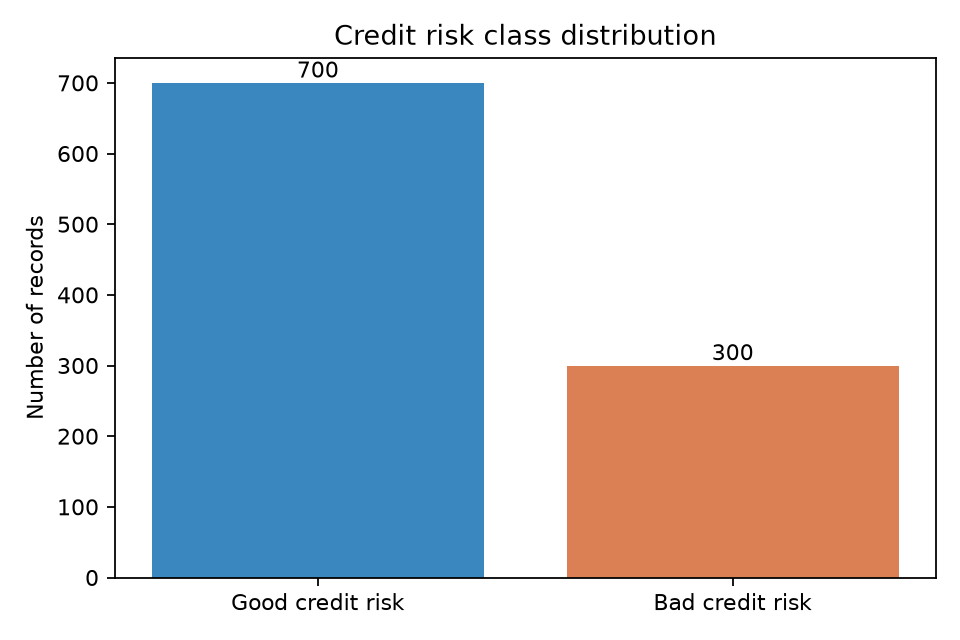
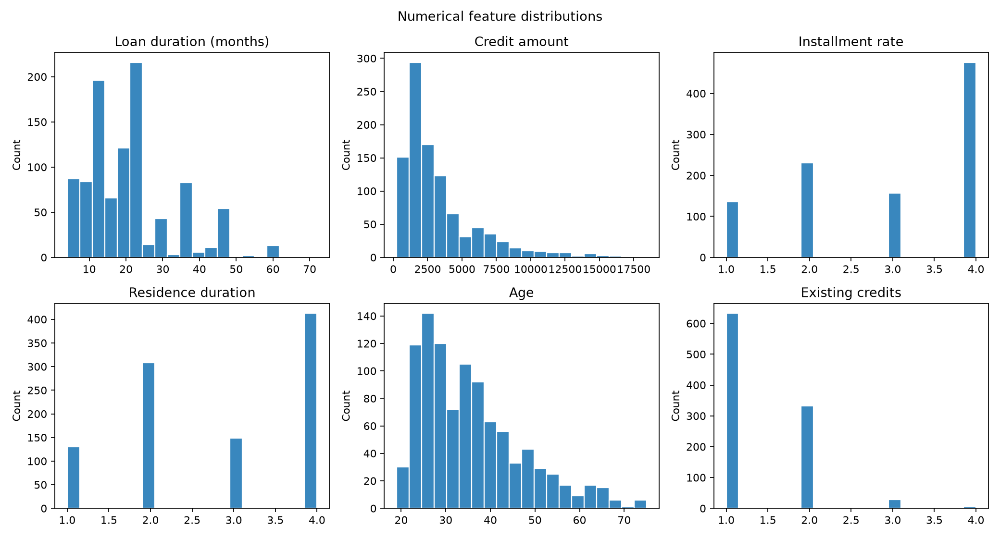
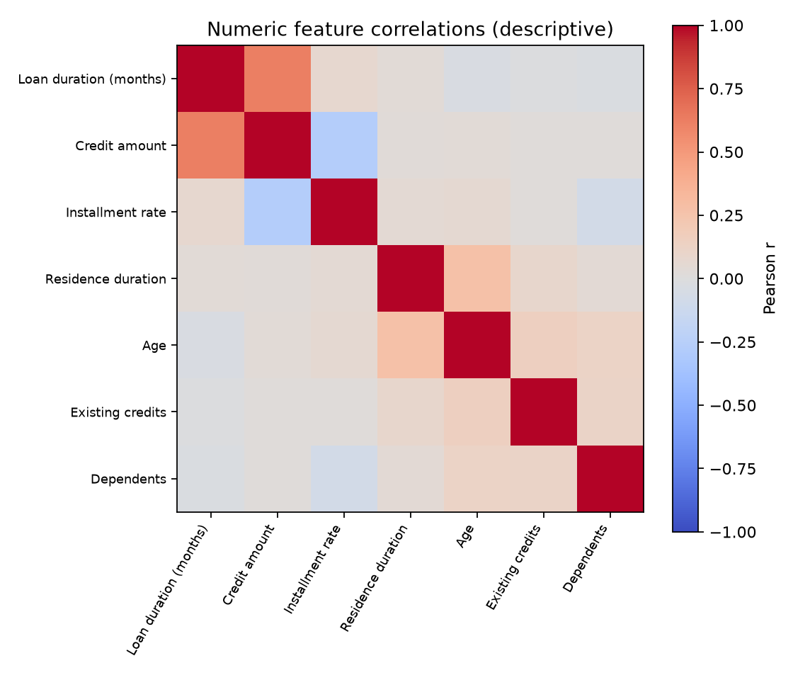
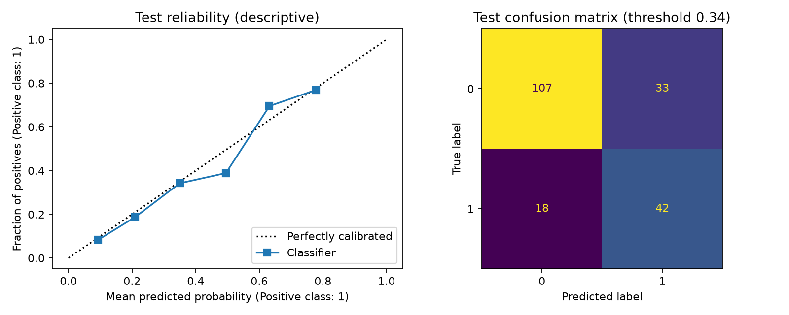

# Explainable Credit Risk Prediction | Reproducible ML Portfolio Project

Independent, educational end-to-end credit risk classification project using the **UCI Statlog (German Credit Data)** benchmark. This is **not** the solution to a graded Lending Club assignment. It does not include the Lending Club dataset, assignment notebook, or graded materials.

## What this project demonstrates

- Binary classification of historical good/bad credit risk labels (**not verified future loan defaults**)
- Stratified 80/20 train–test split and stratified 5-fold cross-validation on training only
- Class-weighted versus unweighted Logistic Regression and Random Forest
- Leakage-safe imputation, scaling, and one-hot encoding in CV pipelines
- GridSearchCV hyperparameter tuning optimizing average precision
- Training-only sigmoid probability calibration
- Training OOF F1-based threshold selection, followed by independent held-out test evaluation
- SHAP explanations of the underlying, uncalibrated model (optional)
- ROC-AUC, average precision, Brier score, log loss, precision, recall, F1, confusion matrix, reliability diagram

## Dataset and license

[UCI Statlog (German Credit Data)](https://archive.ics.uci.edu/dataset/144/statlog+german+credit+data): 1,000 records, 20 features. Original labels are 1=good and 2=bad, mapped to 0=good / 1=bad. The dataset is CC BY 4.0.

**Attribution:** Hofmann, H. (1994). *Statlog (German Credit Data)*. UCI Machine Learning Repository. [DOI: 10.24432/C5NC77](https://doi.org/10.24432/C5NC77).

Data are retrieved directly from UCI when running the code; no raw datasets are committed.

## Run

```bash
python -m venv .venv
# Activate the environment (Windows: .venv\Scripts\activate; macOS/Linux: source .venv/bin/activate)
pip install -r requirements.txt
python -m src.train --output-dir results
```

Requires internet on first run. Use `--no-shap` to skip SHAP. Open the companion notebook with:

```bash
jupyter lab notebooks/credit_risk_walkthrough.ipynb
```

## Reproducibility and interpretation

- Model selection and parameter search use training-set 5-fold CV; the test set is held out.
- Threshold selection uses training-only out-of-fold probabilities from cross-fitted calibration; selected for F1, **not lending profit**.
- Sigmoid calibration is trained only from training folds. The held-out test set is used for evaluation, never calibration fitting.
- SHAP (if installed) explains the underlying uncalibrated estimator on a small sample, not a causal mechanism or calibrated risk.

## Exploratory data analysis (EDA)

The repository includes a reproducible EDA script (`python -m src.eda`). GitHub Actions generates and commits the images in `results/eda/`.

**Target distribution**



**Missing-value assessment**


**Numerical distributions**



**Correlation matrix**



These figures are descriptive and do not establish causality. [See EDA summary](results/eda/eda_summary.json).

## Verified results — GitHub Actions run #1

The independent UCI benchmark evaluation completed successfully on GitHub Actions, with 1,000 records (800 training; 200 held-out test), and 30% bad-credit labels.

| Metric | Held-out test |
|---|---:|
| Selected model | **Random Forest** |
| ROC-AUC | **0.8013** |
| Average precision | **0.6514** |
| Precision | 0.5600 |
| Recall | 0.7000 |
| F1 | 0.6222 |
| Brier score | 0.1578 |
| Log loss | 0.4821 |
| Training-selected threshold | 0.34 |

Confusion matrix: **TN 107, FP 33, FN 18, TP 42**.

Five-fold training CV average precision: Logistic Regression **0.6161**, Random Forest **0.6357**. Selected Random Forest parameters: 150 trees, minimum leaf size 2, no class weighting. Calibration uses sigmoid fitting on training folds; threshold selection uses training-only out-of-fold predictions.



[Full metrics](results/metrics.json) · [Model comparison](results/model_comparison.json) · [Workflow](.github/workflows/evaluate.yml)

These results measure historical **good/bad credit-risk labels**, not prospective loan defaults or production lending decisions.

## Outputs

Running the script writes `results/metrics.json`, `results/model_comparison.json`, `results/evaluation.png`, and optional `results/shap_importance.csv` and `results/shap_bar.png`. The metrics above were generated by the reproducible GitHub Actions evaluation.

## Limitations

This is a small historical classification benchmark, not a deployable approval system. The good/bad labels are not verified prospective default outcomes. Real lending use requires fairness evaluation, regulatory and data governance review, cost-sensitive decisions, temporal validation, external calibration, and monitoring. **Not financial advice.**

## Author

Kanika Bhalla, Ph.D.
